<!-- Generated from README.template.md by scripts/render_readme_cards.py. Edit the template (or config.json), not README.md. -->

  

  

  

  
  
  

Cards are drawn by <code>scripts/render_readme_cards.py</code> and refreshed every day by a GitHub Action.
